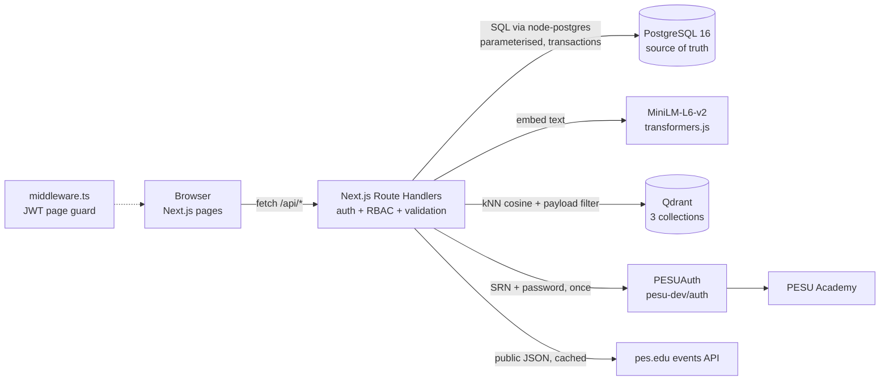

# PESU-Sync — Campus Events & Capstone Teaming Platform

DBMS Experiential Learning **Level 3** project · UE24CS351A · PES University

PESU-Sync replaces WhatsApp groups and notice boards with one searchable, auditable platform where students
form teams for hackathons, coursework and capstones, get **semantic match suggestions**, pitch capstone ideas
for **faculty approval**, and admins moderate everything through a trigger-written **audit trail**.

| | |
|---|---|
| **Team** | P Manas Siddhardha (PES1UG24AM186) · Parth Pandurang Kale (PES1UG24AM184) |
| **Database paradigm** | Option 2 — **SQL + Vector DB**: PostgreSQL 16 + Qdrant 1.15 (two separate services) |
| **Frontend / API** | Next.js 15 (App Router + Route Handlers), React 19, Tailwind CSS 4, Archivo variable font |
| **Embeddings** | `all-MiniLM-L6-v2` (384-d, cosine) run locally in Node via transformers.js — no API key |
| **Auth** | **Log in with PESU Academy** (via [pesu-dev/auth](https://github.com/pesu-dev/auth)) or a PESU-Sync password; JWT in an httpOnly cookie; 3 roles (Student / Faculty / Admin) |
| **College data** | Live events from the public pes.edu events API, cached in PostgreSQL |

Full documentation (ER diagram, relational schema, data dictionary, vector design, queries, screenshots,
test results): **[docs/DOCUMENTATION.md](docs/DOCUMENTATION.md)**

---

## Features

- **Sign in with PESU Academy.** Students enter their SRN/PRN and PESU Academy password; the open-source
  PESUAuth API confirms them with PESU Academy and returns name, SRN, branch and semester. The first sign-in
  creates the PESU-Sync account automatically and marks it *Verified with PESU Academy*. The password is never stored.
- **Or create an account with your PESU email.** The email is always `<srn>@stu.pes.edu`
  (e.g. `pes1ug24am186@stu.pes.edu`), enforced by a database CHECK constraint. Faculty/admins use `@pes.edu`.
- **Happening at PES University.** Events published on pes.edu are pulled from the site's public JSON API,
  cached in PostgreSQL (idempotent UPSERT, refreshed every 30 minutes) and shown on the Events page. Faculty can
  turn any of them into a PESU-Sync team event with one click.
- **Profiles** with skills (proficiency 1–5), bio and past projects — embedded into Qdrant for matching.
- **Team listings** with required skills; join workflow *request → leader/faculty verifies → member → team locked*.
  Capacity, one-team-per-event, deadlines and locking are enforced **inside PostgreSQL** by triggers and stored procedures.
  Capacity is always shown as a row of seats that fill as members join.
- **Match suggestions** (student → teams, team → candidate students): `0.75 × cosine similarity (Qdrant) + 0.25 × skill overlap (SQL function)`.
- **Capstone marketplace**: keyword search (PostgreSQL full-text, GIN index), semantic search (Qdrant), hybrid
  (Reciprocal Rank Fusion), near-duplicate detection, faculty approve/reject with feedback, resubmission.
- **Team messaging** (only members can post — enforced by a trigger).
- **Role-based dashboards** built on SQL views, a materialized view and analytical queries (GROUP BY/HAVING, window functions).
- **Admin moderation**: deactivate/unlock users, create faculty accounts, disband teams, refresh analytics, browse the append-only audit log.
- **Design**: sage/pine/marigold palette, condensed Archivo headings, one orchestrated landing animation (a team
  roster assembling), seat pop-ins when a member is accepted, page fades, skeleton loaders — all disabled under
  `prefers-reduced-motion`.

## Architecture



## Prerequisites

- Node.js **20.9+** (tested on 22)
- Docker Desktop (runs PostgreSQL and Qdrant)
- Internet on first run: the embedding model (~23 MB) and the Archivo font are downloaded once

## Setup

```bash
git clone <your-repo-url> pesu-sync && cd pesu-sync
cp .env.example .env          # set POSTGRES_PASSWORD and JWT_SECRET (32+ chars)
npm install
npm run db:up                 # docker compose: postgres + qdrant
npm run setup                 # schema (db/schema/*.sql) + demo data + vector index
npm run dev                   # http://localhost:3000
```

`npm run setup` = `db:setup` (runs `01_schema.sql` … `06_campus_events.sql` in order, each in its own
transaction) → `db:seed` → `vector:sync`. It is safe to re-run; it resets the demo data.

### Log in with PESU Academy

Works out of the box against the hosted PESUAuth instance (`PESU_AUTH_URL=https://pesuauth.onrender.com`).
The hosted service sleeps when idle, so the first sign-in can take up to a minute. To keep passwords on your own
machine, run PESUAuth yourself and point the app at it:

```bash
docker compose --profile pesu-auth up -d     # starts pesudev/pesu-auth on :5000
```

then set `PESU_AUTH_URL=http://localhost:5000` in `.env`. PESU-Sync only asks PESU Academy for name, SRN, branch,
semester and campus (no email, phone or date of birth) and never stores the PESU password.

### Demo accounts (password for all: `Pesu@2026`)

| Role | Email | Notes |
|---|---|---|
| Admin | `admin@pes.edu` | user management, moderation, audit log |
| Faculty | `kavya.rao@pes.edu` | organises PESU Hackathon 2026, mentors a capstone |
| Faculty | `arjun.mehta@pes.edu` | capstone coordinator |
| Student | `pes1ug23cs101@stu.pes.edu` | Aarav — backend/PostgreSQL profile, pending request |
| Student | `pes1ug23cs104@stu.pes.edu` | Ananya — leader of *CampusEats AI* (has pending requests) |
| Student | `pes1ug23cs103@stu.pes.edu` | Rohan — leader of *MediScan*, approved capstone |

These are test credentials created by `db/seed/seed.ts`; change them before any real deployment.

## Scripts

| Command | What it does |
|---|---|
| `npm run dev` / `npm run build` / `npm start` | Next.js dev server / production build / production server |
| `npm run db:up` / `npm run db:down` | start / stop the PostgreSQL + Qdrant containers |
| `npm run db:setup` | apply all DDL in `db/schema` (DROP + CREATE + ALTER, views, functions, triggers, FTS, campus events) |
| `npm run db:seed` | load demo users, events, teams, requests, capstones (through the real procedures) |
| `npm run vector:sync [-- --reset]` | (re-)embed profiles, teams and capstones into Qdrant |
| `npm run test:db` | 27 database + vector tests (constraints, triggers, procedures, transactions, concurrency, kNN) |
| `npm run test:api` | 11 end-to-end API tests (needs the app running on `BASE_URL`, default `http://localhost:3000`) |
| `npm run typecheck` | TypeScript check |

The two PESU Academy / pes.edu API tests use a local mock instead of real credentials. Start the app with
`PESU_AUTH_URL=http://localhost:5055` and `CAMPUS_EVENTS_URL=http://localhost:5055/wp-json/tribe/events/v1/events`
(for example in `.env.local`), then run `PESU_MOCK_PORT=5055 npm run test:api`; without these they are skipped.

## Project structure

```
db/
  schema/01_schema.sql            tables, PK/FK, CHECK/UNIQUE, indexes            (CREATE, DROP)
  schema/02_auth_alter.sql        auth + PESU Academy columns, email rules         (ALTER)
  schema/03_functions_triggers.sql functions, stored procedures, triggers, audit
  schema/04_views.sql             views + materialized view for dashboards
  schema/05_fulltext_search.sql   tsvector column, GIN index, ranked search function
  schema/06_campus_events.sql     cache of pes.edu events + sync log
  queries/important_queries.sql   the key DML / analytical queries, documented
  seed/seed.ts                    demo data
scripts/                          db-setup, vector-sync, env loader
src/
  middleware.ts                   page-level JWT + role guard
  lib/db.ts                       pg pool, withTransaction (sets app.user_id for audit)
  lib/auth.ts, lib/jwt.ts         bcrypt, JWT, requireUser(roles)
  lib/pesu-auth.ts                PESUAuth client (Log in with PESU Academy)
  lib/campus-events.ts            pes.edu events sync (UPSERT + cleanup)
  lib/http.ts                     error mapping (constraint / trigger errors -> HTTP), input parsing
  lib/embeddings.ts, lib/vector.ts MiniLM embeddings, Qdrant collections, sync, kNN search
  app/api/**/route.ts             REST API (auth, events, campus-events, teams, join-requests, matches, capstones, search, admin)
  app/**/page.tsx                 UI pages; app/template.tsx page transition; components/ui.tsx design kit
tests/                            db.test.ts, vector.test.ts, api.test.ts
docs/                             DOCUMENTATION.md, screenshots/
```

## Requirement checklist

| Requirement | Where |
|---|---|
| SQL DB (PostgreSQL) + vector DB (Qdrant) | `docker-compose.yml`, `src/lib/db.ts`, `src/lib/vector.ts` |
| ER diagram → relational schema | `docs/DOCUMENTATION.md` §3–4 |
| CREATE / ALTER / DROP, PK/FK, constraints, indexes, views | `db/schema/01`–`06` |
| DML + JOIN / GROUP BY / HAVING / ORDER BY / aggregates / subqueries / window | `db/queries/important_queries.sql`, `src/app/api/dashboard/route.ts` |
| ≥4 advanced SQL concepts | transactions, stored procedures + functions, triggers, indexing (B-tree, partial, GIN), views + materialized view, full-text search, UPSERT |
| NoSQL/vector concept | Qdrant cosine kNN with payload filters, hybrid ranking, RRF |
| Next.js UI with forms, tables, search, filters, dashboards | `src/app/**` |
| API layer, env-based config, no hard-coded credentials | `src/app/api/**`, `.env.example`, `.gitignore` |
| Backend authentication + ≥2 roles | `src/lib/auth.ts`, `src/lib/pesu-auth.ts`, `src/middleware.ts`, `requireUser()` in every route |
| DB-level validation & integrity | CHECK/UNIQUE/FK constraints, validation triggers, append-only audit log |
| Tests | `tests/` (38 automated tests) |

## Troubleshooting

- **Port 5432 already in use** – set `POSTGRES_PORT=5433` in `.env`, then `npm run db:down && npm run db:up`.
- **PESU Academy sign-in times out** – the hosted PESUAuth was asleep; try again, or self-host it (see above).
- **No internet for the model download** – set `EMBEDDING_PROVIDER=hash` and run `npm run vector:sync -- --reset`
  (keyword-level fallback embeddings, same 384 dimensions).
- **Reset everything** – `npm run setup`.

## Team

| Member | SRN | Responsibilities |
|---|---|---|
| P Manas Siddhardha | PES1UG24AM186 | Core schema DDL, triggers / stored procedures / transactions, Qdrant vector layer + embeddings, team-formation workflow (API + UI), match suggestions, profile, landing page + design tokens, seed data, DB + vector test suites |
| Parth Pandurang Kale | PES1UG24AM184 | Authentication & RBAC incl. Log in with PESU Academy (ALTER DDL, JWT, middleware), UI kit + motion, views + materialized view + analytical queries, role-based dashboards, events + live pes.edu events, capstone module + full-text search, admin moderation, API test suite, documentation |
