# PESU-Sync — Project Documentation

**Campus Events & Capstone Teaming Platform** · UE24CS351A DBMS Experiential Learning, Level 3

| Member | SRN |
|---|---|
| P Manas Siddhardha | PES1UG24AM186 |
| Parth Pandurang Kale | PES1UG24AM184 |

Contents: 1 Objectives · 2 Functional requirements · 3 ER diagram · 4 Relational schema · 5 Database choice ·
6 Data dictionary · 7 SQL implementation · 8 Vector database implementation · 9 Important queries ·
10 System architecture · 11 Security & integrity · 12 Screenshots · 13 Testing results · 14 Conclusion ·
15 Individual contributions

---

## 1. Objectives

1. One platform for **event teaming and capstone team formation**, with status tracking from request to resolution.
2. **Semantic (vector) similarity** to suggest Student ↔ Team matches by meaning (description, tech stack, domain), not only exact keywords.
3. A **campus-restricted** space (students `<srn>@stu.pes.edu`, faculty/admins `@pes.edu`) for listings, capstone pitches, role requirements and peer messaging.
4. **Role-based access** (Admin, Faculty, Student) so team verification, capstone approval and moderation are controlled.
5. A complete, **auditable trail** of team formation (requested → verified → locked / approved), written by the database.
6. Sound **relational design** next to a genuinely **separate vector database**, integrated through a secure Next.js application.

## 2. Functional requirements

| # | Requirement | Implemented by |
|---|---|---|
| FR1 | Students register (campus email + SRN) and maintain a profile: bio, skills with proficiency, past projects | `/register`, `/profile`, `api/auth/register`, `api/profile` |
| FR2 | Faculty/Admin create events with team-size limits and registration deadlines | `/events`, `api/events` |
| FR3 | Students post team listings with category, description, required skills, deadline | `/teams/new`, `api/teams` |
| FR4 | Students request to join; the leader (or faculty) accepts/rejects; leader locks the final roster | `api/teams/[id]/join`, `api/join-requests/[id]`, `api/teams/[id]/lock` |
| FR5 | Automatic match suggestions Student → Teams and Team → Students | `/matches`, `api/matches`, `api/teams/[id]/suggestions` |
| FR6 | Capstone pitching, browsing, filtering, keyword + semantic + hybrid search, faculty approval | `/capstones/*`, `api/capstones/*` |
| FR7 | Near-duplicate capstone detection | similar pitches on `/capstones/[id]` and `/capstones/new` |
| FR8 | Peer messaging inside a team | `api/teams/[id]/messages` |
| FR9 | Role-based dashboards | `/dashboard`, `api/dashboard` |
| FR10 | Admin moderation: users (activate, unlock, role, create), disband teams, refresh analytics, audit log | `/admin/*`, `api/admin/*` |
| FR11 | Students log in with their PESU Academy SRN/PRN + password; the first login creates a verified account | `/login`, `api/auth/pesu`, `lib/pesu-auth.ts` |
| FR12 | Show events currently published on pes.edu; faculty can turn one into a team event | `/events`, `api/campus-events`, `lib/campus-events.ts` |

## 3. ER diagram

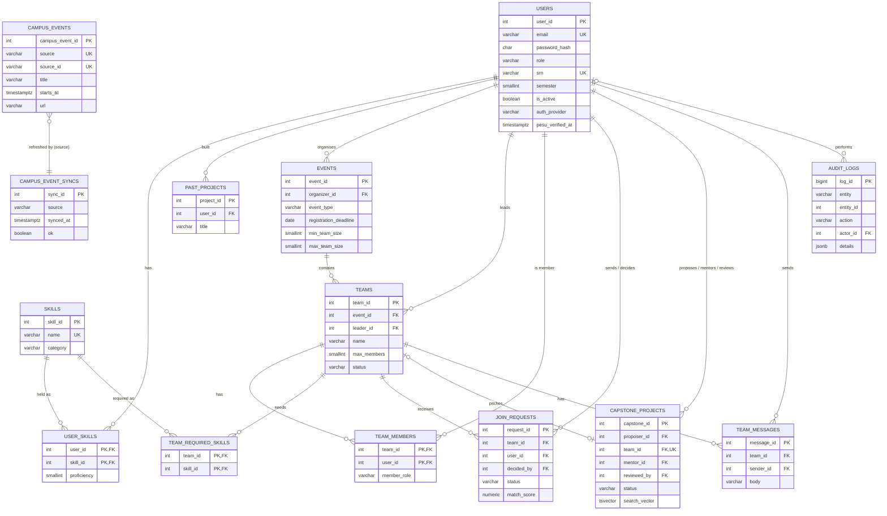

**Relationship summary**

| Relationship | Cardinality | Implemented as |
|---|---|---|
| User *has* Skill | M:N (with attribute proficiency) | `user_skills` |
| Team *needs* Skill | M:N | `team_required_skills` |
| User *member of* Team | M:N (with attribute member_role) | `team_members` |
| Event *contains* Team | 1:N (total participation of Team) | `teams.event_id` NOT NULL |
| User *leads* Team | 1:N | `teams.leader_id` |
| User *requests* Team | M:N over time (history kept) | `join_requests` (+ partial unique index for one PENDING) |
| Team *pitches* Capstone | 1:1, optional | `capstone_projects.team_id` UNIQUE, nullable |
| User *proposes / mentors / reviews* Capstone | three 1:N roles | `proposer_id`, `mentor_id`, `reviewed_by` |

## 4. Relational schema

Underline = primary key, → = foreign key.

```
USERS(user_id, full_name, email, password_hash, role, srn, department, semester, bio,
      is_active, created_at, updated_at, last_login_at, failed_logins, auth_provider, pesu_verified_at)
SKILLS(skill_id, name, category)
USER_SKILLS(user_id → USERS, skill_id → SKILLS, proficiency)                PK(user_id, skill_id)
PAST_PROJECTS(project_id, user_id → USERS, title, description, project_url, year)
EVENTS(event_id, title, event_type, description, organizer_id → USERS, start_date, end_date,
       registration_deadline, min_team_size, max_team_size, created_at)
TEAMS(team_id, event_id → EVENTS, leader_id → USERS, name, description, category, max_members,
      status, deadline, locked_at, created_at, updated_at)                    UNIQUE(event_id, name)
TEAM_REQUIRED_SKILLS(team_id → TEAMS, skill_id → SKILLS)                    PK(team_id, skill_id)
TEAM_MEMBERS(team_id → TEAMS, user_id → USERS, member_role, joined_at)      PK(team_id, user_id)
JOIN_REQUESTS(request_id, team_id → TEAMS, user_id → USERS, message, match_score, status,
              created_at, decided_at, decided_by → USERS)
CAPSTONE_PROJECTS(capstone_id, title, abstract, domain, tech_stack, proposer_id → USERS,
                  team_id → TEAMS, mentor_id → USERS, status, feedback, submitted_at,
                  reviewed_at, reviewed_by → USERS, search_vector)
TEAM_MESSAGES(message_id, team_id → TEAMS, sender_id → USERS, body, sent_at)
AUDIT_LOGS(log_id, entity, entity_id, action, old_value, new_value, actor_id → USERS, details, created_at)
CAMPUS_EVENTS(campus_event_id, source, source_id, title, starts_at, ends_at, all_day, venue, url, summary,
              fetched_at)                                                    UNIQUE(source, source_id)
CAMPUS_EVENT_SYNCS(sync_id, source, synced_at, fetched, ok, error)
```

**Normalisation.** Every table is in 3NF/BCNF: all non-key attributes depend only on the key. Multi-valued facts
(skills of a user, skills a team needs, team membership) are separate relations instead of arrays/CSV columns.
Derived values (member count, open slots, participants per event) are *not stored*; they are computed in views,
except `teams.status`, which is a workflow state maintained by triggers.

## 5. Database choice and justification

| Data | Nature | Store | Why |
|---|---|---|---|
| Users, roles, credentials, events, teams, memberships, join requests, capstones, messages, audit log | Structured, related, must stay consistent under concurrent updates | **PostgreSQL** | Fixed schema, FK/CHECK/UNIQUE integrity, ACID transactions and row locks for team locking/acceptance, triggers and procedures for workflow rules, views for reporting, full-text search for keywords |
| Free text: student bio + skills + past projects, team listing descriptions + required skills, capstone title + abstract | Unstructured, must be matched *by meaning* | **Qdrant** | “looking for a backend dev comfortable with databases” must match “SQL, API design, Node.js”. LIKE / full-text only match shared words; a vector DB does approximate nearest-neighbour search (HNSW) on embeddings with payload filtering |

PostgreSQL is the **source of truth**. Qdrant holds a derived, rebuildable index (`npm run vector:sync -- --reset`).
Each Qdrant point id *is* the SQL primary key, so every vector hit is resolved back to a full row with a join.

## 6. Data dictionary

### users
| Column | Type | Constraints / meaning |
|---|---|---|
| user_id | SERIAL | PK |
| full_name | VARCHAR(100) | NOT NULL, CHECK trimmed length ≥ 2 |
| email | VARCHAR(120) | NOT NULL, UNIQUE, CHECK lower-case, CHECK campus format (added by ALTER): a STUDENT must be exactly `lower(srn)@stu.pes.edu`, faculty/admins `@pes.edu` |
| password_hash | CHAR(60) | NOT NULL, CHECK bcrypt format `$2a/b/y$NN$` (ALTER) |
| role | VARCHAR(10) | NOT NULL DEFAULT 'STUDENT', CHECK IN (STUDENT, FACULTY, ADMIN) |
| srn | VARCHAR(13) | UNIQUE, CHECK format `PES[12](UG|PG)YYXXNNN` |
| department | VARCHAR(60) | NOT NULL DEFAULT 'CSE' |
| semester | SMALLINT | CHECK 1–8; CHECK a STUDENT must have srn and semester |
| bio | TEXT | used for embeddings |
| is_active | BOOLEAN | NOT NULL DEFAULT TRUE — users are deactivated, never deleted |
| created_at / updated_at | TIMESTAMPTZ | updated_at maintained by trigger |
| last_login_at | TIMESTAMPTZ | added by ALTER |
| failed_logins | SMALLINT | NOT NULL DEFAULT 0, CHECK 0–100; login refused at ≥ 5 until an admin unlocks |
| auth_provider | VARCHAR(5) | NOT NULL DEFAULT 'LOCAL', CHECK IN (LOCAL, PESU) — PESU = created by a PESU Academy login (ALTER) |
| pesu_verified_at | TIMESTAMPTZ | last time PESU Academy confirmed the SRN; CHECK PESU accounts must have it and only students can have it (ALTER) |

### skills / user_skills / past_projects
| Table.Column | Type | Constraints |
|---|---|---|
| skills.skill_id | SERIAL | PK |
| skills.name | VARCHAR(50) | NOT NULL UNIQUE |
| skills.category | VARCHAR(20) | CHECK IN (LANGUAGE, FRAMEWORK, DATABASE, AI_ML, DESIGN, DEVOPS, DOMAIN, SOFT_SKILL) |
| user_skills.(user_id, skill_id) | INT, INT | PK; FK users ON DELETE CASCADE; FK skills ON DELETE RESTRICT |
| user_skills.proficiency | SMALLINT | NOT NULL DEFAULT 3, CHECK 1–5 |
| past_projects.project_id | SERIAL | PK; user_id FK CASCADE |
| past_projects.project_url | VARCHAR(255) | CHECK starts with http(s):// |
| past_projects.year | SMALLINT | CHECK 2015–2100 |

### events
| Column | Type | Constraints |
|---|---|---|
| event_id | SERIAL | PK |
| title | VARCHAR(120) | NOT NULL; UNIQUE(title, start_date) |
| event_type | VARCHAR(12) | CHECK IN (HACKATHON, COURSEWORK, CAPSTONE, COMPETITION, WORKSHOP) |
| organizer_id | INT | FK users ON DELETE RESTRICT |
| start_date, end_date, registration_deadline | DATE | NOT NULL; CHECK end ≥ start AND deadline ≤ end |
| min_team_size, max_team_size | SMALLINT | CHECK 1 ≤ min ≤ max ≤ 10 |

### teams / team_members / team_required_skills
| Table.Column | Type | Constraints |
|---|---|---|
| teams.team_id | SERIAL | PK |
| teams.event_id | INT | FK events ON DELETE CASCADE |
| teams.leader_id | INT | FK users; trigger: must be an active STUDENT |
| teams.name | VARCHAR(80) | UNIQUE(event_id, name) |
| teams.description | TEXT | CHECK length ≥ 20 |
| teams.category | VARCHAR(12) | CHECK IN (WEB, MOBILE, AI_ML, DATA, SYSTEMS, SECURITY, IOT, RESEARCH, DESIGN, OTHER) |
| teams.max_members | SMALLINT | CHECK 2–10; trigger: ≤ event.max_team_size and ≥ current member count |
| teams.status | VARCHAR(10) | CHECK IN (RECRUITING, FULL, LOCKED, DISBANDED); RECRUITING↔FULL maintained by trigger |
| teams.locked_at | TIMESTAMPTZ | CHECK status = LOCKED ⇒ locked_at NOT NULL |
| team_members.(team_id, user_id) | INT, INT | PK; both FK CASCADE |
| team_members.member_role | VARCHAR(10) | CHECK IN (LEADER, MEMBER); partial UNIQUE index: one LEADER per team |
| team_required_skills.(team_id, skill_id) | INT, INT | PK; FKs |

### join_requests
| Column | Type | Constraints |
|---|---|---|
| request_id | SERIAL | PK |
| team_id, user_id | INT | FK CASCADE; partial UNIQUE (team_id, user_id) WHERE status = 'PENDING' |
| message | VARCHAR(500) | |
| match_score | NUMERIC(5,4) | CHECK −1..1 — cosine similarity profile↔team at request time |
| status | VARCHAR(10) | CHECK IN (PENDING, ACCEPTED, REJECTED, WITHDRAWN) |
| decided_at | TIMESTAMPTZ | CHECK (status = PENDING) ⇔ (decided_at IS NULL) |
| decided_by | INT | FK users ON DELETE SET NULL |

### capstone_projects
| Column | Type | Constraints |
|---|---|---|
| capstone_id | SERIAL | PK |
| title | VARCHAR(150) | NOT NULL UNIQUE |
| abstract | TEXT | CHECK length ≥ 50 |
| domain / tech_stack | VARCHAR | domain NOT NULL |
| proposer_id | INT | FK users CASCADE |
| team_id | INT | FK teams SET NULL, UNIQUE (one pitch per team); trigger: proposer must be a member |
| mentor_id | INT | FK users; trigger: must be FACULTY |
| status | VARCHAR(10) | CHECK IN (DRAFT, SUBMITTED, APPROVED, REJECTED) |
| feedback | TEXT | CHECK REJECTED ⇒ feedback present |
| reviewed_at, reviewed_by | TIMESTAMPTZ, INT | CHECK APPROVED/REJECTED ⇒ both present; trigger: reviewer is FACULTY/ADMIN |
| search_vector | TSVECTOR | GENERATED ALWAYS … STORED (weighted title A, domain+stack B, abstract C); GIN index |

### team_messages / audit_logs
| Table.Column | Type | Constraints |
|---|---|---|
| team_messages.body | VARCHAR(1000) | CHECK not blank; trigger: sender must be a team member |
| audit_logs.log_id | BIGSERIAL | PK |
| audit_logs.entity / entity_id | VARCHAR(30) / INT | table name and row id of the audited row |
| audit_logs.action | VARCHAR(20) | CHECK IN (CREATED, STATUS_CHANGE, DELETED) |
| audit_logs.old_value / new_value | VARCHAR(30) | status before / after |
| audit_logs.actor_id | INT | FK users (no cascade — history must survive) |
| audit_logs.details | JSONB | snapshot of the created row (password hash removed) |
| (table) | | BEFORE UPDATE/DELETE trigger raises `IMMUTABLE` → append-only |

### campus_events / campus_event_syncs (cache of pes.edu)
| Table.Column | Type | Constraints |
|---|---|---|
| campus_events.campus_event_id | SERIAL | PK |
| campus_events.(source, source_id) | VARCHAR(20), VARCHAR(40) | UNIQUE — the natural key used by `INSERT … ON CONFLICT` |
| campus_events.title / venue / summary | VARCHAR(255) / VARCHAR(255) / TEXT | plain text (HTML stripped, entities decoded) |
| campus_events.starts_at / ends_at | TIMESTAMPTZ | NOT NULL start; CHECK ends_at ≥ starts_at; index on starts_at |
| campus_events.url | VARCHAR(500) | NOT NULL, CHECK starts with http(s):// |
| campus_event_syncs.synced_at / fetched / ok / error | TIMESTAMPTZ / INT / BOOLEAN / TEXT | one row per refresh; CHECK fetched ≥ 0; CHECK a failed refresh records its error |

## 7. SQL implementation

All DDL lives in `db/schema` and is applied in order by `npm run db:setup`, each file in its own transaction.

| File | DDL demonstrated |
|---|---|
| `01_schema.sql` | `DROP … CASCADE` (re-runnable), `CREATE TABLE` ×12, PK/FK with `ON DELETE CASCADE / RESTRICT / SET NULL`, CHECK (incl. regex and multi-column), UNIQUE (single, composite, **partial unique indexes**), 17 secondary indexes (composite, partial `WHERE is_active`, descending) |
| `02_auth_alter.sql` | `ALTER TABLE … ADD COLUMN`, `ADD CONSTRAINT` (role-aware email rule, PESU Academy columns), `ALTER COLUMN … TYPE`, `DROP COLUMN` |
| `03_functions_triggers.sql` | 14 PL/pgSQL / SQL functions, 14 triggers, 2 stored procedures |
| `04_views.sql` | 6 views, 1 materialized view + unique index for `REFRESH … CONCURRENTLY` |
| `05_fulltext_search.sql` | generated `tsvector` column, GIN index, set-returning search function |
| `06_campus_events.sql` | cache tables for pes.edu events; natural-key UNIQUE used by `INSERT … ON CONFLICT DO UPDATE` |

### 7.1 Advanced concepts

| Concept | Where | What it does |
|---|---|---|
| **Transactions** | `withTransaction()` in `src/lib/db.ts`; register, create team, profile update, accept/lock, disband | Multi-statement writes are atomic; `app.user_id` is set with `set_config(…, true)` so triggers know the actor |
| **Row locking / concurrency** | `SELECT … FOR UPDATE` in `fn_check_team_capacity`, `sp_accept_join_request`, `sp_lock_team` | Two leaders/faculty accepting the last slot at the same time: exactly one succeeds (tested) |
| **Stored procedures** | `sp_accept_join_request(request, actor)`, `sp_lock_team(team, actor)` | Authorise actor, add member, mark request, withdraw the student's other requests in the event, auto-reject queue when FULL; lock checks the event's minimum size |
| **Functions** | `fn_team_member_count`, `fn_skill_overlap`, `fn_current_actor`, `fn_search_capstones` | Used in views, ORDER BY, the hybrid match score and full-text search |
| **Triggers** | 14 (see below) | Business rules that no client can bypass |
| **Indexing** | B-tree, composite `(event_id, status)`, partial unique, GIN on `tsvector` | Filters on status/event/user, one pending request per team/student, fast `@@` |
| **Views** | `v_team_overview`, `v_active_recruiting_teams`, `v_student_profiles`, `v_event_summary`, `v_capstone_overview`, `v_join_request_details` | Joins + aggregates reused by every listing/dashboard; hide password hashes |
| **Materialized view** | `mv_skill_demand` | Skill demand (teams needing) vs supply (students having); refreshed concurrently by admin |
| **Full-text search** | `search_vector` + `websearch_to_tsquery` + `ts_rank_cd` + `ts_headline` | Ranked keyword search with highlighted snippets |
| **UPSERT sync** | `src/lib/campus-events.ts` | pes.edu events: `INSERT … ON CONFLICT (source, source_id) DO UPDATE` + delete of withdrawn events + sync log row, all in one transaction; refreshed at most every 30 min |
| **Vector similarity search** | Qdrant (section 8) | Semantic matching, semantic search, duplicate detection |

**Triggers**

| Trigger | Table / timing | Rule |
|---|---|---|
| trg_users_updated_at, trg_teams_updated_at | BEFORE UPDATE | maintain `updated_at` |
| trg_teams_validate | teams BEFORE INSERT/UPDATE | leader is an active student; max_members ≤ event limit and ≥ members; re-evaluates FULL/RECRUITING when size changes |
| trg_team_members_capacity | team_members BEFORE INSERT | locks team row; refuses LOCKED/DISBANDED (`TEAM_CLOSED`), over capacity (`TEAM_FULL`), second team in the same event (`ALREADY_IN_TEAM`) |
| trg_team_members_leave | team_members BEFORE DELETE | no leaving a LOCKED team |
| trg_team_members_sync_status | team_members AFTER INSERT/DELETE | RECRUITING → FULL at capacity, FULL → RECRUITING when someone leaves |
| trg_join_requests_validate | join_requests BEFORE INSERT | only active students, team RECRUITING, deadline not passed, not already in a team for the event |
| trg_team_messages_sender | team_messages BEFORE INSERT | sender must be a member |
| trg_capstone_validate | capstone_projects BEFORE INSERT/UPDATE | mentor is faculty, reviewer is faculty/admin, proposer belongs to the linked team |
| trg_audit_teams / _join_requests / _capstones | AFTER INSERT or UPDATE OF status | write CREATED / STATUS_CHANGE rows with the actor |
| trg_audit_team_members | AFTER INSERT/DELETE | membership history |
| trg_audit_logs_immutable | audit_logs BEFORE UPDATE/DELETE | append-only |

Trigger/procedure errors start with a code word (`TEAM_FULL: …`). `src/lib/http.ts` maps the code word — and
named constraint violations — to HTTP 400/403/404/409 with a readable message, so validation that happens in the
database is what the user sees.

## 8. Vector database implementation (Qdrant)

| Item | Design |
|---|---|
| **What is embedded** | *student_profiles*: “Skills: … . bio . Past projects: …” · *team_listings*: “name. category team for event (type). Looking for: skills. description” · *capstone_pitches*: “title. Domain: … Tech stack: … abstract” |
| **Model** | `sentence-transformers/all-MiniLM-L6-v2` (ONNX int8, `Xenova/all-MiniLM-L6-v2`) run inside Node with transformers.js; mean pooling + L2 normalisation; 384 dimensions. Fallback `EMBEDDING_PROVIDER=hash` (feature hashing) for offline use |
| **Storage** | 3 collections, `size = 384`, `distance = Cosine`, HNSW index (Qdrant default). Point id = SQL primary key |
| **Payload / metadata** | profiles: user_id, department, semester, skills · teams: team_id, event_id, status, category · capstones: capstone_id, status, domain · all: `text` (the embedded document) and `indexed_at` |
| **Payload indexes** | keyword: department, status, category, domain · integer: semester, event_id |
| **Similarity metric** | Cosine similarity (vectors are normalised, so it equals the dot product) |
| **Sync** | after every SQL write that changes embedded text (profile save, team create/edit/accept/lock, capstone create/review) the row is re-embedded and upserted; rows that are no longer eligible (inactive user, disbanded team) are deleted from the index; missing vectors are created lazily; `npm run vector:sync` rebuilds everything |

**Retrieval strategy**

1. *Student → Teams* (`/api/matches`): fetch the student's stored vector → kNN (k = 30) in `team_listings` with
   payload filter `status = RECRUITING` → resolve ids in PostgreSQL with `UNNEST … WITH ORDINALITY` joined to
   `v_active_recruiting_teams`, removing the student's own team and events they are already teamed up in (SQL is
   the source of truth, so stale payloads cannot leak) → **score = 0.75 × cosine + 0.25 × fn_skill_overlap()** →
   top 10 with matched / missing skills.
2. *Team → Students* (`/api/teams/[id]/suggestions`): same, using the team vector against `student_profiles`.
3. *Semantic search* (`/api/search/semantic`): embed the query text → kNN → resolve rows, keep Qdrant's order.
4. *Capstone hybrid search*: PostgreSQL full-text list and Qdrant list fused with **Reciprocal Rank Fusion**
   (`Σ 1/(60 + rank)`).
5. *Duplicate detection*: nearest pitches to a pitch's own vector (`must_not has_id` excludes itself);
   cosine ≥ 0.6 is flagged as a possible duplicate.
6. *Join request fit*: cosine(profile, team) is stored in `join_requests.match_score` so the leader can sort applicants.

## 9. Important queries

All key statements are collected and commented in [`db/queries/important_queries.sql`](../db/queries/important_queries.sql):

| # | Query | Concepts |
|---|---|---|
| Q1 | Register student + skills | INSERT, `jsonb_to_recordset`, transaction |
| Q2 | Successful login | UPDATE |
| Q3 | Member leaves | DELETE (+ status trigger) |
| Q4 | Browse recruiting teams needing a skill | view with JOINs, `= ANY(array)`, ORDER BY |
| Q5 | Open events a student has not joined | correlated `NOT EXISTS` subquery |
| Q6 | Skill gaps | GROUP BY + **HAVING**, `COUNT(DISTINCT)` |
| Q7 | Users per role | aggregate with `FILTER` |
| Q8 | Departments ranked by participation | derived table + **window function** `RANK()` |
| Q9 | Average review turnaround | `AVG(EXTRACT(EPOCH FROM interval))` |
| Q10 | Accept request | `CALL` stored procedure in a transaction |
| Q11 | Teams ranked by skill overlap | stored function in ORDER BY |
| Q12 | Capstone keyword search | full-text search function |
| Q13 | Resolve vector hits | `UNNEST … WITH ORDINALITY` join |
| Q14 | Analytics refresh | `REFRESH MATERIALIZED VIEW CONCURRENTLY` |
| Q15 | Capstone audit trail | JOIN on audit log |
| — | Audit summary (admin) | `GROUP BY ROLLUP` |

## 10. System architecture

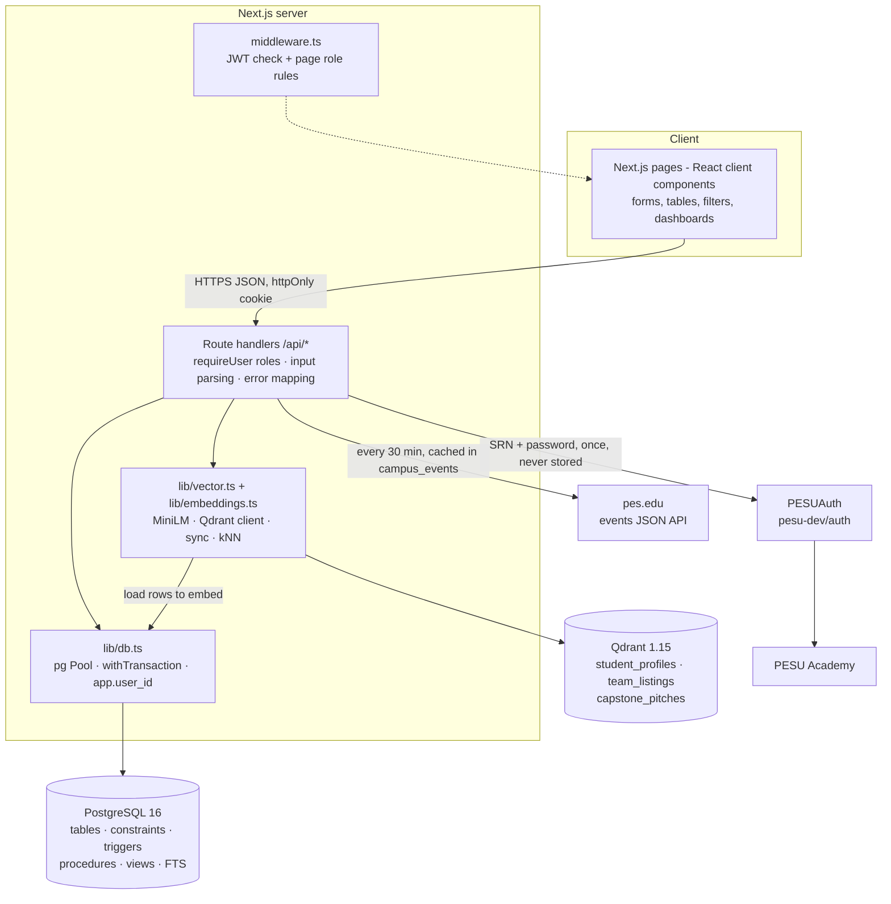

Request flow example — *log in with PESU Academy*: `/login` → `POST /api/auth/pesu` → PESUAuth checks the
SRN/PRN + password with PESU Academy and returns name, SRN, branch, semester → an existing student with that SRN is
signed in (and `pesu_verified_at` updated), otherwise a STUDENT row is inserted with `auth_provider = 'PESU'`,
email `<srn>@stu.pes.edu` and an unusable random password hash → JWT cookie → new users land on their profile.

Request flow example — *accept a join request*: page → `PATCH /api/join-requests/:id` → `requireUser()` (JWT +
fresh role check in SQL) → `BEGIN; set_config('app.user_id'); CALL sp_accept_join_request(); COMMIT` → triggers check
capacity, sync status, write audit rows → vector payload of the team re-synced → JSON response.

## 11. Security and data integrity

- **Credentials**: only bcrypt hashes are stored (DB CHECK enforces the bcrypt format). 5 failed logins lock the account.
- **PESU Academy passwords** are forwarded once to PESUAuth over HTTPS and never stored or logged by PESU-Sync. Only
  name, SRN, branch, semester and campus are requested (no email, phone or date of birth). `PESU_AUTH_URL` can point to
  a self-hosted PESUAuth (`docker compose --profile pesu-auth up -d`) so the password only reaches PESU Academy.
- **External data**: pes.edu event text is stored as plain text (HTML stripped) and links open in a new tab.
- **Sessions**: HS256 JWT (8 h) in an `httpOnly`, `SameSite=Lax` cookie (`Secure` in production).
- **Authorisation**: page guard in `middleware.ts` **and** `requireUser(...roles)` in every API route; the role and
  `is_active` are re-read from PostgreSQL on each request, so deactivation takes effect immediately. Procedures
  and triggers re-check authorisation (e.g. only the leader/faculty can accept; only members can post).
- **Configuration**: all secrets come from `.env` (git-ignored); `.env.example` documents them. Nothing is hard-coded.
- **SQL injection**: every query is parameterised (`$1, $2 …`).
- **XSS**: React escapes output; full-text highlights use `[[ ]]` markers rendered as `<mark>` elements, never raw HTML.
- **Integrity**: FK actions chosen per relationship (CASCADE for owned rows, RESTRICT for organisers/leaders, SET NULL for
  optional references); users are deactivated, never deleted; the audit log is append-only.

## 12. Application screenshots

| | |
|---|---|
| 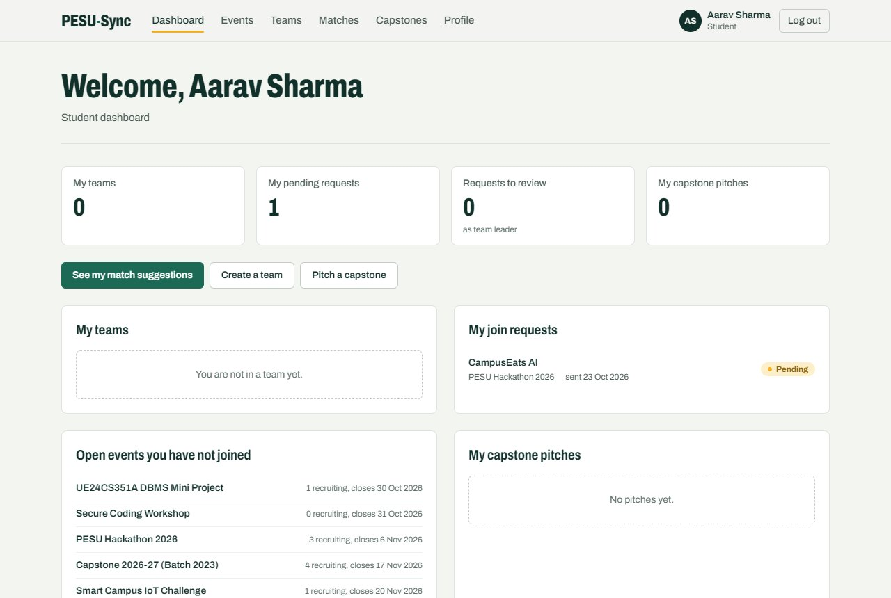 Student dashboard | 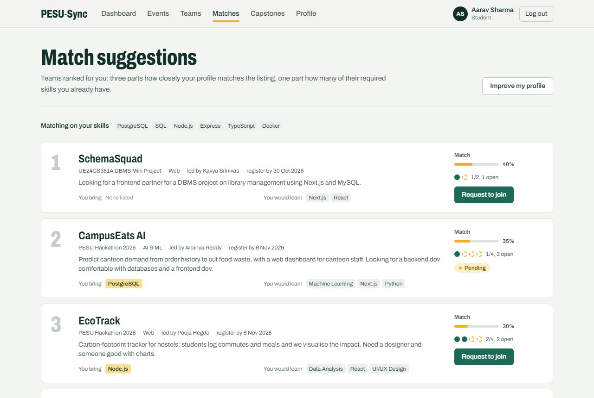 Match suggestions (cosine + skill overlap) |
| 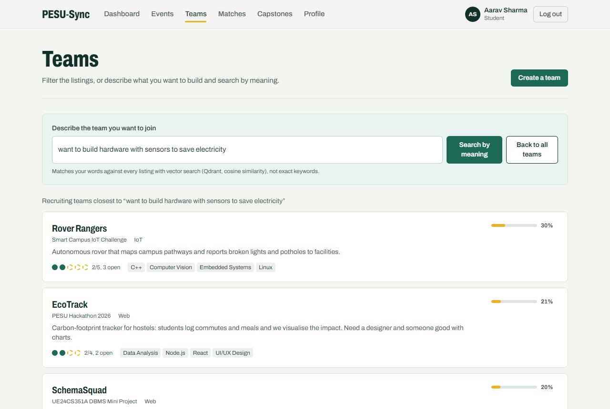 Semantic team search | 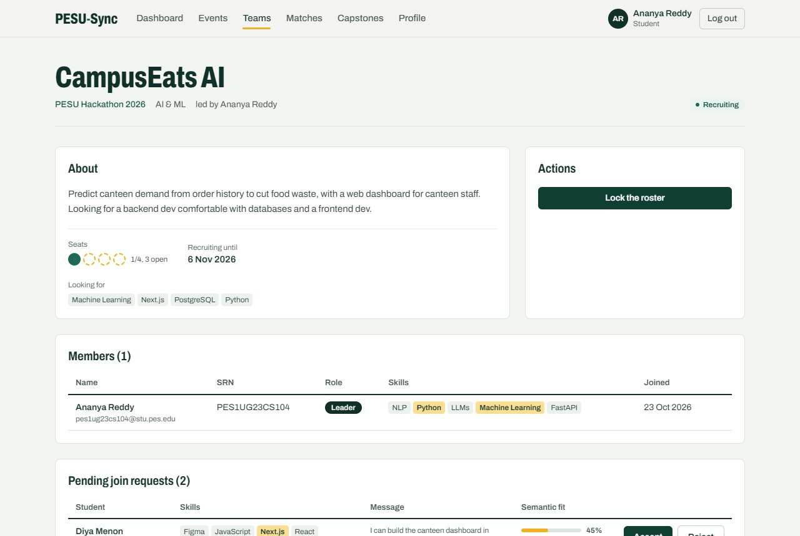 Team leader: pending requests with semantic fit |
| 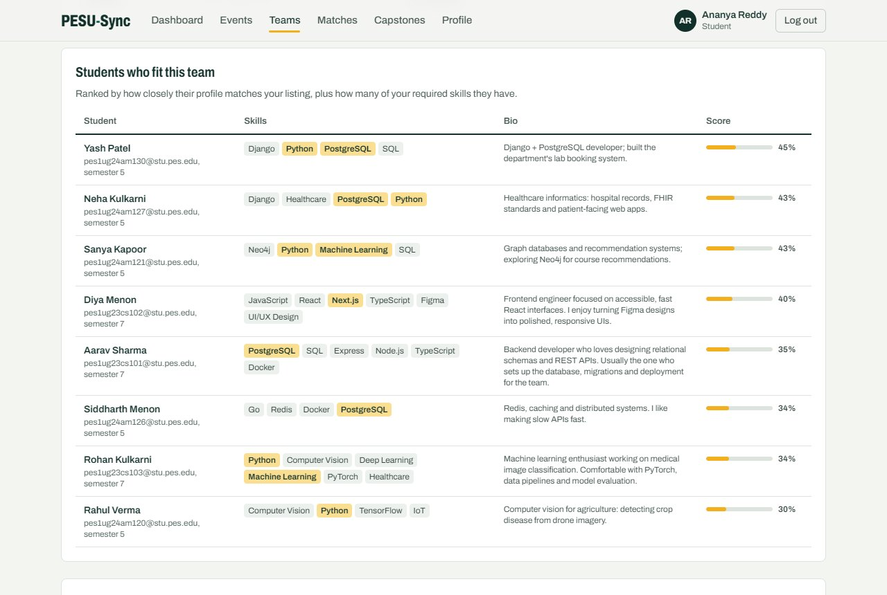 Suggested candidates for a team | 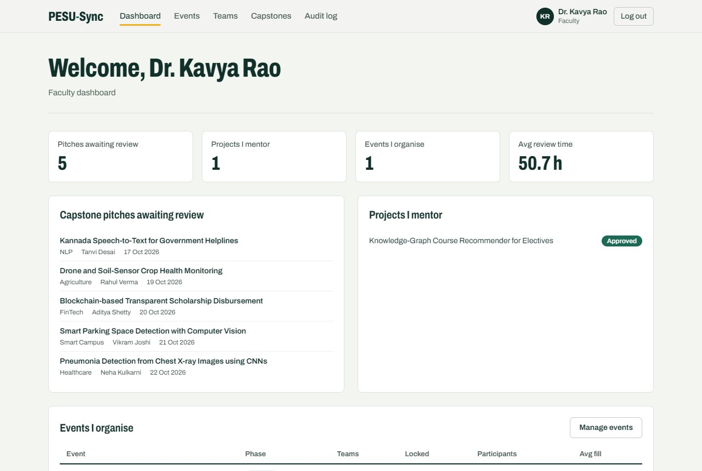 Faculty dashboard |
| 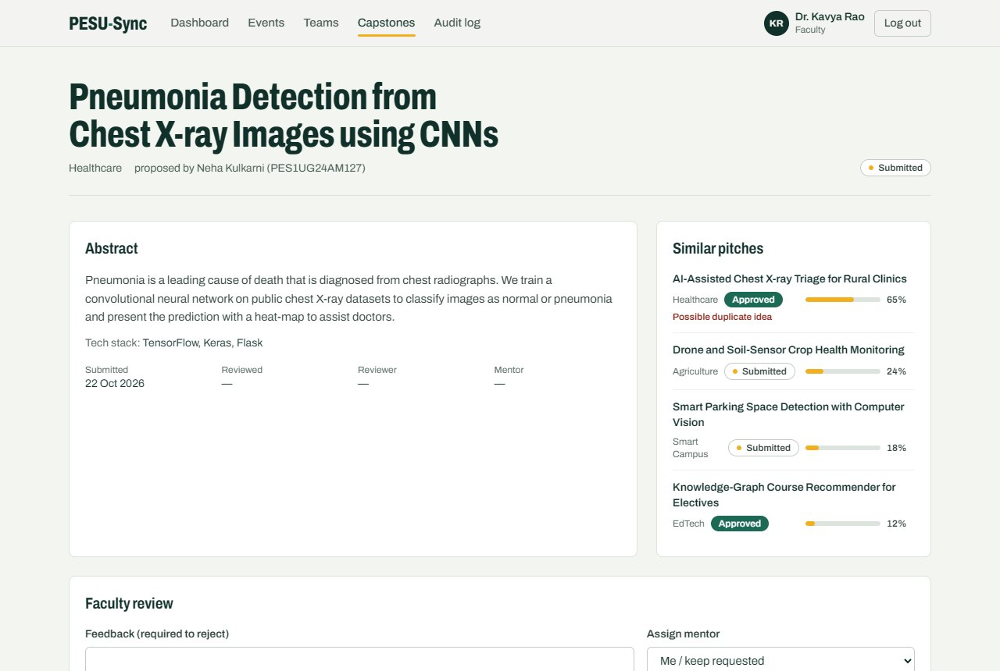 Capstone review + similar pitches | 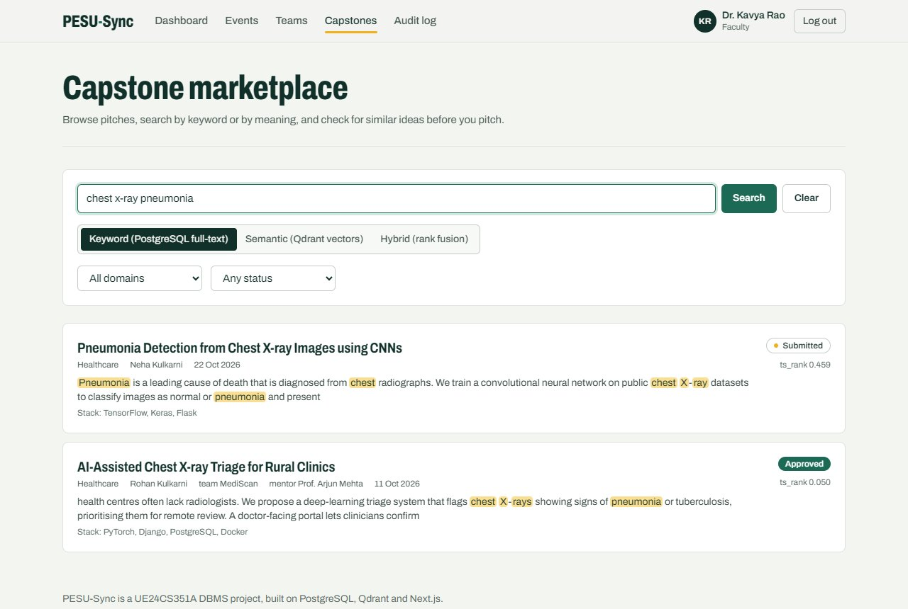 Capstone full-text search with highlights |
| 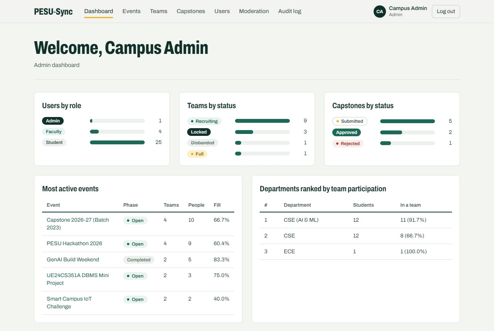 Admin dashboard | 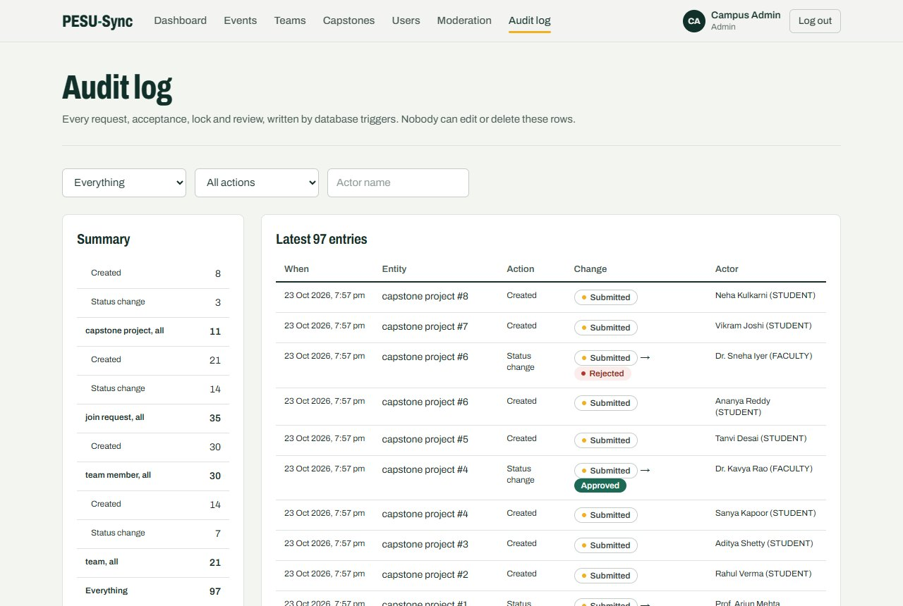 Trigger-written audit log |
| 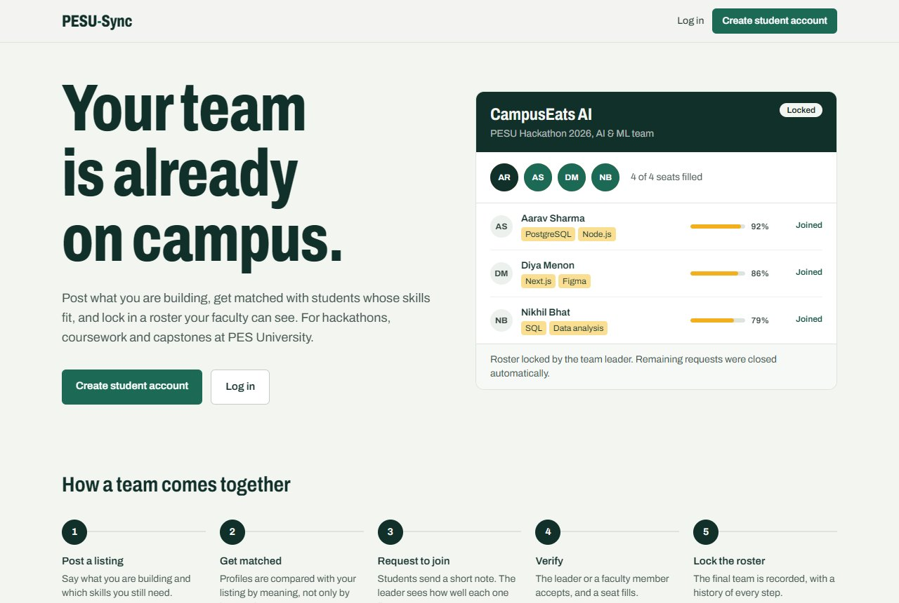 Landing page: a team roster assembling | 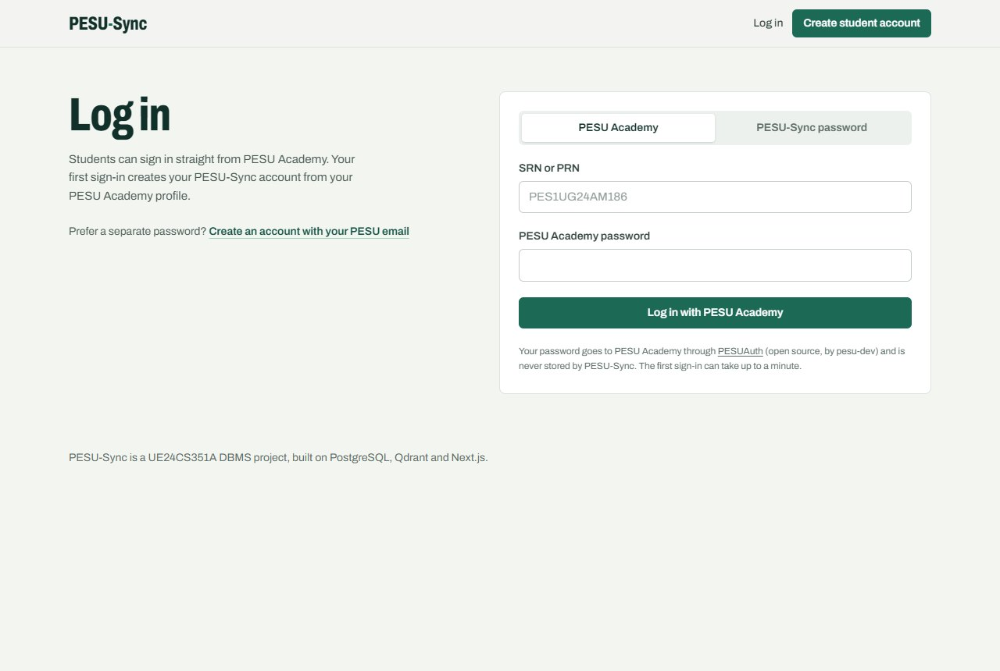 Log in with PESU Academy or a PESU-Sync password |
| 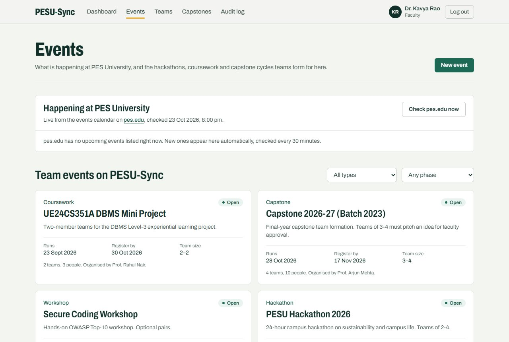 Events, with the live pes.edu feed on top | |

## 13. Testing results

Run with `npm run test:db` (database + vector) and `npm run test:api` (app running). Result on the reference
machine (Windows 11, Node 22, PostgreSQL 16, Qdrant 1.15): **38 / 38 passed**.

**Database tests (`tests/db.test.ts`, 23 tests — each runs in a rolled-back transaction)**

| Area | Test | Result |
|---|---|---|
| Constraints | non-campus email rejected (`chk_users_email_campus`) | pass |
| | student email must be exactly `<srn>@stu.pes.edu`; staff cannot use the student domain | pass |
| | malformed SRN rejected (regex CHECK) | pass |
| | student without semester rejected (multi-column CHECK) | pass |
| | plain-text password rejected (bcrypt CHECK) | pass |
| | duplicate email rejected (UNIQUE) | pass |
| | team for non-existent event rejected (FK) | pass |
| | inconsistent event dates rejected (CHECK) | pass |
| Triggers | RECRUITING → FULL at capacity and back on leave | pass |
| | adding beyond capacity → `TEAM_FULL` | pass |
| | second team in the same event → `ALREADY_IN_TEAM` | pass |
| | team larger than event limit → `TEAM_TOO_LARGE` | pass |
| | request to locked team → `TEAM_CLOSED` | pass |
| | request after deadline → `DEADLINE_PASSED` | pass |
| | non-member message → `FORBIDDEN` | pass |
| | status changes audited with actor; audit log UPDATE/DELETE → `IMMUTABLE` | pass |
| Procedures | accept adds member and withdraws the student's other requests in the event | pass |
| | non-leader student cannot accept → `FORBIDDEN` | pass |
| | accepting last slot → FULL + queue auto-rejected | pass |
| | lock enforces minimum size; members cannot leave a locked team | pass |
| | `fn_skill_overlap` = 0.75 for 3 of 4 skills | pass |
| Transactions | failure mid-transaction leaves no half-created team | pass |
| | two concurrent accepts for the last slot → exactly one succeeds | pass |

**Vector tests (`tests/vector.test.ts`, 4 tests)**: 384-d unit vectors · “backend dev comfortable with databases” is
closer to “SQL, API design, Node.js” than to an art profile · Qdrant upsert + filtered kNN excludes filtered
points · seeded backend/PostgreSQL student ranks in the top 3 for the synopsis query — **all pass**.

**API tests (`tests/api.test.ts`, 11 tests)**: anonymous → 401 · wrong password → 401 and page redirect to
`/login` · student on admin/faculty endpoints → 403 · registration with a gmail or non-SRN email → 400 from the DB CHECK, email derived from SRN when omitted · full team
workflow (create → request with stored match score → duplicate request 409 → non-leader accept 403 → accept →
lock → late request 409 → audit shows LOCKED) · capstone pitch → student review 403 → reject without feedback 400
→ faculty approve · keyword search highlights + semantic results sorted by similarity · match score =
0.75·cosine + 0.25·overlap · admin user listing + materialized view refresh — **all pass**.

**PESU Academy and pes.edu** (2 of the 11 API tests, run against a local mock of PESUAuth and of the pes.edu
events API because real credentials cannot be used in tests): wrong PESU password → 401 · first PESU login → 201,
account created with `<srn>@stu.pes.edu`, title-cased name, semester parsed, `auth_provider = PESU`, verified
timestamp · second login → 200, no duplicate · the stored random password cannot be used · campus events: students
cannot force a refresh (403) · titles decoded, HTML stripped, venue stored · refreshing twice does not duplicate rows
— **all pass**. Against the live services: pes.edu sync succeeds (0 upcoming events listed at the time of testing)
and PESUAuth rejects invalid credentials with 401, mapped to a clear message.

## 14. Conclusion

PESU-Sync shows how the data itself decides the database: the team-formation workflow is relational and
concurrent, so PostgreSQL enforces it with constraints, triggers, procedures, row locks and an append-only audit
trail, while free-text profiles, listings and pitches are matched by meaning in Qdrant. The two are joined through
shared primary keys, with PostgreSQL as the source of truth, and exposed through an authenticated, role-aware
Next.js application. Future work: scheduling integration for meetings, alumni mentorship matching and multi-campus
deployment (row-level tenancy).

## 15. Individual contributions

| Area | P Manas Siddhardha (PES1UG24AM186) | Parth Pandurang Kale (PES1UG24AM184) |
|---|---|---|
| Database | `01_schema.sql` (all tables, keys, constraints, indexes), `03_functions_triggers.sql` (functions, procedures, triggers, audit), Qdrant collections / payload indexes / embeddings / sync | `02_auth_alter.sql` (ALTER incl. PESU Academy columns), `04_views.sql` (views + materialized view), `05_fulltext_search.sql` (FTS), `06_campus_events.sql` (UPSERT cache), `important_queries.sql` |
| Application | project scaffold + Docker + DB client, design tokens + landing page animation, profile page/API, team listing / detail / join / accept / lock / messages APIs + pages, match suggestions, semantic search API | JWT auth + RBAC middleware, Log in with PESU Academy, login/register, UI kit + motion, role-based dashboards, events module + live pes.edu events, capstone module (search, review, resubmit), admin moderation |
| Testing / docs | seed data, DB test suite, vector test suite | API test suite, README, this documentation |

Commit history on GitHub shows the same split (6 commits each).
